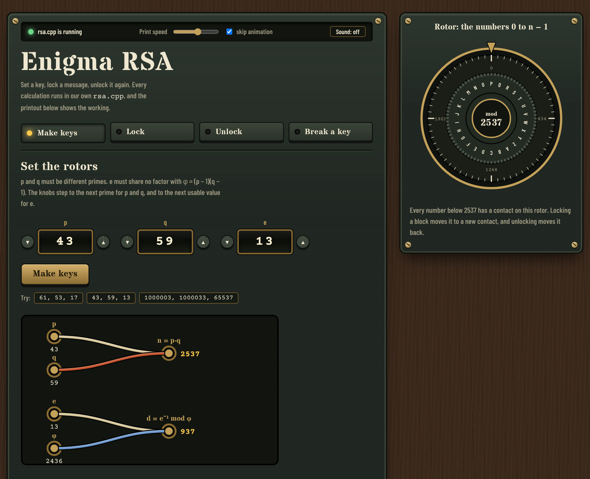
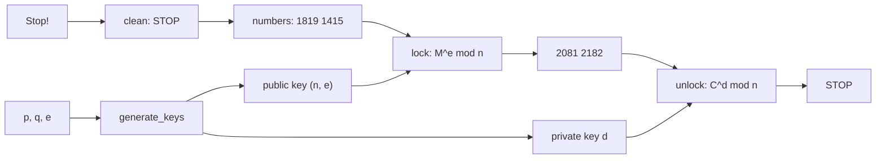
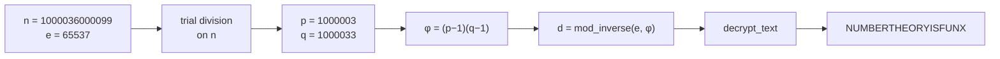
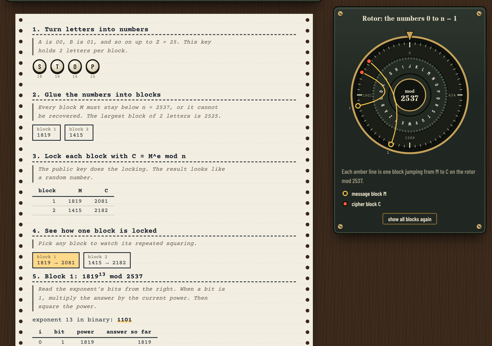
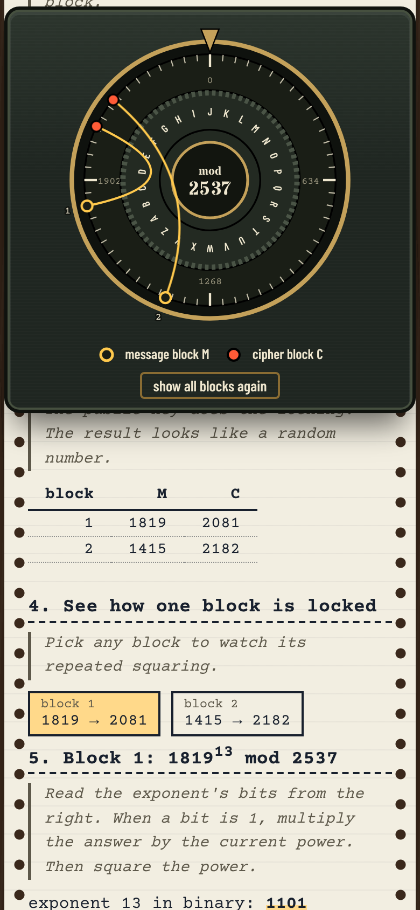

<div align="center">



# Enigma RSA

### RSA written from scratch in C++17, with an Enigma-style web workbench that shows every step of the working

[](#quick-start)
[](#the-web-workbench)
[](#design-notes)
[](#team)

**[Open the live workbench](https://shortbatman.github.io/enigma-rsa/)** &nbsp;·&nbsp; [Quick start](#quick-start) &nbsp;·&nbsp; [How RSA works](#rsa-in-two-minutes) &nbsp;·&nbsp; [Break a key](#breaking-a-key)

</div>

---

## What is this?

This is our final project for **Discrete Structures (Fall 2026)** at FAST-NUCES. It builds RSA from the number theory up, using nothing but 64-bit integers:

- **Modular arithmetic:** multiplication that never overflows, and fast exponentiation.
- **The extended Euclidean algorithm:** forward division, then back-substitution, to find the private key.
- **Key generation and text encryption:** whole messages are turned into numbers, locked in blocks and unlocked again.
- **An attack:** a toy key is broken by trial division, so you can see why real keys are huge.
- **A web workbench:** built like an Enigma machine, it runs *our own* C++ code in the browser and prints the working as it goes.

> Every number fits in an `unsigned long long`. No GMP, no Boost, no OpenSSL, no `__int128`.

## Contents

- [RSA in two minutes](#rsa-in-two-minutes)
- [Quick start](#quick-start)
- [The functions](#the-functions)
- [Breaking a key](#breaking-a-key)
- [The web workbench](#the-web-workbench)
- [Design notes](#design-notes)
- [Project structure](#project-structure)
- [Team](#team)
- [Sources and credits](#sources-and-credits)

## RSA in two minutes

Pick two primes `p` and `q`, and a number `e`. Everything else follows. Here is the example from the course, with `p = 43`, `q = 59`, `e = 13`.



**1. Make the keys**

| | |
| --- | --- |
| `n = p · q` | 43 × 59 = **2537** (public) |
| `φ = (p − 1)(q − 1)` | 42 × 58 = **2436** (secret) |
| `d = e⁻¹ mod φ` | the number with 13 · d ≡ 1 (mod 2436), found below |

To find `d`, divide forward with Euclid's algorithm on (2436, 13):

| dividend | divisor | quotient | remainder |
| ---: | ---: | ---: | ---: |
| 2436 | 13 | 187 | 5 |
| 13 | 5 | 2 | 3 |
| 5 | 3 | 1 | 2 |
| 3 | 2 | 1 | 1 |
| 2 | 1 | 2 | 0 |

Then substitute backward, turning (x, y) into (y, x − q·y) for each quotient from the bottom up:

| quotient | x | y |
| ---: | ---: | ---: |
| start | 1 | 0 |
| 2 | 0 | 1 |
| 1 | 1 | −1 |
| 1 | −1 | 2 |
| 2 | 2 | −5 |
| 187 | −5 | **937** |

So `d = 937`, and indeed 13 × 937 = 12181 = 5 × 2436 + 1.

**2. Lock a message.** The letters A to Z become 00 to 25. With `n = 2537` a block holds two letters, so `STOP` becomes the blocks `1819` and `1415`. Each block `M` is locked with `C = M^e mod n`:

```
1819^13 mod 2537 = 2081
1415^13 mod 2537 = 2182
```

The ciphertext is `2081 2182`.

**3. Unlock it.** Anyone can lock with the public key `(2537, 13)`. Only the owner of `d = 937` can reverse it with `M = C^d mod n`:

```
2081^937 mod 2537 = 1819  →  ST
2182^937 mod 2537 = 1415  →  OP
```

The code does exactly this, and the [web workbench](#the-web-workbench) shows every row of every step.

## Quick start

You need a C++17 compiler such as `g++`.

```bash
git clone https://github.com/ShortBatman/enigma-rsa.git
cd enigma-rsa
```

**Run the tests**

```bash
g++ -std=c++17 -O2 rsa.cpp test_rsa.cpp -o test_rsa
./test_rsa
```

```
All tests passed
```

**Try the interactive demo**

```bash
g++ -std=c++17 -O2 rsa.cpp demo.cpp -o demo
./demo
```

```
Enter p q e: 43 59 13
Public key: n = 2537, e = 13
Private key: d = 937
Block size: 2 letters
Message: Stop!
Cleaned: STOP
Plaintext blocks: 1819 1415
Ciphertext: 2081 2182
Decrypted: STOP
```

If the key is bad (for example a `p` that is not prime), the demo prints the reason and asks again.

On Windows PowerShell, run the programs as `.\test_rsa` and `.\demo`.

## The functions

Each function builds on the ones before it. Bad input throws `std::invalid_argument`.

| Function | What it does |
| --- | --- |
| `mul_mod(a, b, m)` | (a·b) mod m by repeated doubling, so the product never overflows 64 bits |
| `mod_exp(b, n, m)` | bⁿ mod m by square-and-multiply, using `mul_mod` for every product |
| `gcd(a, b)` | Euclidean algorithm |
| `extended_gcd(a, b, s, t)` | gcd plus the numbers s and t with gcd = s·a + t·b, by forward division and back-substitution |
| `mod_inverse(a, m)` | the inverse of a mod m, in the range 0 to m − 1 |
| `is_prime(n)` | trial division, stopping at √n |
| `generate_keys(p, q, e, n, d)` | checks p, q and e, then builds n = p·q and d = e⁻¹ mod φ |
| `encrypt(M, n, e)` / `decrypt(C, n, d)` | one block, M^e mod n and C^d mod n |
| `block_size(n)` | how many letters fit in one block, so that ZZ…Z (2525…25) stays below n |
| `encrypt_text` / `decrypt_text` | whole messages to and from ciphertext blocks |

## Breaking a key

`break_key.cpp` attacks a toy public key using only the functions above:



```bash
g++ -std=c++17 -O2 rsa.cpp break_key.cpp -o break_key
./break_key
```

```
p = 1000003
q = 1000033
Private key d = 983264276609
Message: NUMBERTHEORYISFUNX
```

The final `X` is padding added by `encrypt_text`, so the message reads NUMBER THEORY IS FUN. The attack takes about a million divisions and a few milliseconds. For a real 2048-bit key the same attack would need about 10³⁰⁸ divisions, which is why real RSA uses huge primes.

## The web workbench

The UI is built like an Enigma machine: push-switches, a lampboard, rotor windows for `p`, `q` and `e`, and a typewriter that prints the working on paper. The look comes from the Enigma, but the cipher is RSA.

<table>
<tr>
<td width="62%"></td>
<td width="38%"></td>
</tr>
</table>

- **Four modes:** make keys, lock a message, unlock a message, break a key.
- **Every step on paper:** Euclid's tables for `d`, the letter and block encoding, and the square-and-multiply table for each block. Each result carries a stamp such as "matches mod_exp in rsa.cpp".
- **A working rotor:** the side panel shows the numbers 0 to n − 1 on a wheel. Dots and arcs show where each block moves, and the wheel clicks forward as the printout grows.
- **A patch board:** after making keys, cables plug `p` and `q` into `n`, and `e` and `φ` into `d`.
- **Extras:** optional key-click sounds, voice input for the message (Chrome or Edge), and a phone layout with the rotor pinned above the printout.

**It runs our own C++.** `rsa.cpp` is compiled to WebAssembly with [wasi-sdk](https://github.com/WebAssembly/wasi-sdk), together with a small bridge file (`ui/ui_bridge.cpp`). The result is embedded in a single HTML page, so no RSA library is involved and there is nothing to install. The page draws its step tables itself and checks every final value against the answer from `rsa.cpp`.

**Run it:** open the [live workbench](https://shortbatman.github.io/enigma-rsa/), or open `index.html` from this repo in a browser.

**Rebuild it** (only needed if you change the C++ or the page):

```bash
WASI_SDK=/path/to/wasi-sdk ./ui/build_wasm.sh
```

This compiles `rsa.cpp` and `ui/ui_bridge.cpp` to `ui/rsa.wasm`, then `ui/build_page.py` embeds the wasm and fonts into `ui/rsa_ui.html`. Copy that file to `index.html` in the repo root for GitHub Pages.

## Design notes

- **No overflow.** For `n` around 10¹², the product of two numbers below `n` is about 10²⁴, which does not fit in 64 bits. So every product goes through `mul_mod`, which adds with doubling and never forms the big product. All moduli stay below 2⁶³ so `a + a` is safe.
- **`d <= n / d` instead of `d * d <= n`** in `is_prime`, because `d * d` can overflow while `n / d` cannot.
- **A careful `mod_inverse`.** The Bézout number `s` can be negative, so it is reduced with `s % (long long)m`. Without the cast, C++ silently turns a negative `s` into a huge unsigned number and the answer is wrong.
- **Block size.** A block holds `k` letters, where `k` is the largest number such that `2525…25` (2k digits) is less than `n`, up to 9. Cipher blocks are written with as many digits as `n` has, padded with zeros, and separated by single spaces.
- **Wrong keys are detected.** `decrypt_text` throws if a decrypted block contains a two-digit value above 25.
- **Plain data structures.** `extended_gcd` saves its quotients in a plain array (Euclid's algorithm on 64-bit numbers needs fewer than 100 steps), and `rsa.cpp` has its own `is_letter` and `to_capital` helpers, so the C++ needs only `<string>` and `<stdexcept>`.
- **Tests that cannot be skipped.** `test_rsa.cpp` uses a small `check` function instead of `assert`, so the checks still run in a build with `-DNDEBUG`. It covers every example from the project description, the worked examples from Part A, and the error cases.

## Project structure

```
enigma-rsa/
├── rsa.h              declarations
├── rsa.cpp            all the RSA functions
├── test_rsa.cpp       tests for every function
├── demo.cpp           interactive encrypt and decrypt demo
├── break_key.cpp      breaks the toy key
├── index.html         the web workbench (a copy of ui/rsa_ui.html, for GitHub Pages)
├── ui/
│   ├── ui_bridge.cpp      thin wrapper that exposes rsa.cpp to JavaScript
│   ├── wasm_throw.h       turns `throw` into a trap for the WebAssembly build
│   ├── build_wasm.sh      compiles to WebAssembly and builds the page
│   ├── build_page.py      embeds the wasm and fonts into one HTML file
│   ├── index.template.html
│   ├── rsa.wasm
│   ├── rsa_ui.html
│   └── fonts/
└── docs/              screenshots
```

## Limitations

The keys here are tiny and exist for learning. Real RSA uses primes hundreds of digits long, random padding such as OAEP, and a vetted library. **Do not use this to protect real data.**

## Team

| Name | Roll number | GitHub |
| --- | --- | --- |
| Umer Hassan | 25L-0656 | [@ShortBatman](https://github.com/ShortBatman) |
| Hamiz Anwar | 25L-0507 | [@HamizAnwar2627](https://github.com/HamizAnwar2627) |

## Sources and credits

- Kenneth Rosen, *Discrete Mathematics and Its Applications*, and the course lecture slides.
- An AI assistant (Claude, by Anthropic) helped with the code and with building the web workbench.
- Fonts, embedded in the page under the SIL Open Font License: [Stardos Stencil](https://fonts.google.com/specimen/Stardos+Stencil), [Barlow Condensed](https://fonts.google.com/specimen/Barlow+Condensed) and [Courier Prime](https://fonts.google.com/specimen/Courier+Prime).
- The page runs on [wasi-sdk](https://github.com/WebAssembly/wasi-sdk) output and the browser's Web Speech API for voice input.
