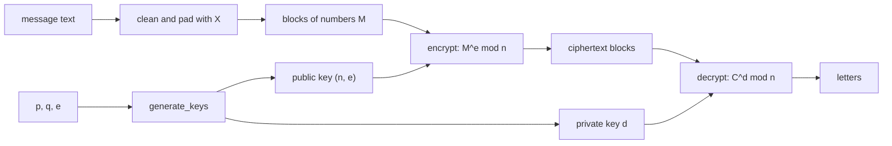

<div align="center">

# 🔐 RSA From Scratch

**RSA encryption, key generation and a key-breaking attack, built in C++17 with no big-number or crypto libraries.**


</div>

---

## About

This is a course project for **Discrete Structures (Fall 2026)** at FAST-NUCES. It works through the number theory behind RSA and then builds the whole thing from scratch: modular arithmetic, the extended Euclidean algorithm, key generation, text encryption in blocks, and an attack that breaks a small key.

Every number fits in a 64-bit `unsigned long long`. Products that would overflow 64 bits are handled by a custom `mul_mod`, so no `__int128`, GMP, Boost or OpenSSL is needed.

## How it works



Letters are encoded as A = 00, B = 01, ..., Z = 25. A block holds as many letters as fit below `n`, and each ciphertext block is written with the same number of digits as `n`.

## The functions

Each function builds on the ones before it.

| Function | What it does |
| --- | --- |
| `mul_mod(a, b, m)` | (a·b) mod m by repeated doubling, so a product never overflows |
| `mod_exp(b, n, m)` | bⁿ mod m by fast exponentiation, using `mul_mod` |
| `gcd(a, b)` | Euclidean algorithm |
| `extended_gcd(a, b, s, t)` | gcd plus the Bézout numbers s and t, using forward division and back-substitution |
| `mod_inverse(a, m)` | Inverse of a mod m, built on `extended_gcd` |
| `is_prime(n)` | Trial division up to √n |
| `generate_keys(p, q, e, n, d)` | Builds n = p·q and the private key d, with input checks |
| `encrypt` / `decrypt` | M^e mod n and C^d mod n for one block |
| `block_size(n)` | How many letters fit in one block |
| `encrypt_text` / `decrypt_text` | Whole messages to and from ciphertext blocks |

Bad input (for example a non-prime p, p equal to q, or a bad e) throws `std::invalid_argument`.

## Project structure

```
.
├── rsa.h            declarations
├── rsa.cpp          all the RSA functions
├── test_rsa.cpp     tests for every function
├── demo.cpp         interactive encrypt and decrypt demo
├── break_key.cpp    breaks a small public key
├── ui/              web UI (rsa_ui.html) and its build files
└── README.md
```

## Build and run

You need a C++17 compiler such as `g++`.

**Run the tests**

```bash
g++ -std=c++17 -O2 rsa.cpp test_rsa.cpp -o test_rsa
./test_rsa
```

This prints `All tests passed`.

**Try the demo**

```bash
g++ -std=c++17 -O2 rsa.cpp demo.cpp -o demo
./demo
```

```
Enter p q e: 43 59 13
Public key: n = 2537, e = 13
Private key: d = 937
Block size: 2 letters
Message: Stop!
Cleaned: STOP
Plaintext blocks: 1819 1415
Ciphertext: 2081 2182
Decrypted: STOP
```

**Break the key**

```bash
g++ -std=c++17 -O2 rsa.cpp break_key.cpp -o break_key
./break_key
```

```
p = 1000003
q = 1000033
Private key d = 983264276609
Message: NUMBERTHEORYISFUNX
```

The final `X` is padding added by `encrypt_text`, so the message reads "NUMBER THEORY IS FUN".

## Web UI (bonus)

`ui/rsa_ui.html` is a single page that animates every RSA step: Euclid's table for `d`, the letter and block encoding, the square-and-multiply table for each block, and the key-breaking attack. It also has voice input for the message (Chrome or Edge). The page runs our own `rsa.cpp` compiled to WebAssembly, so no RSA library is used. Just open the file in a browser.

To rebuild it you need [wasi-sdk](https://github.com/WebAssembly/wasi-sdk): `WASI_SDK=/path/to/wasi-sdk ./ui/build_wasm.sh`

## The attack

`break_key.cpp` is given a public key `(n, e)` and a ciphertext. It factors `n` by trial division, finds φ = (p − 1)(q − 1), computes the private key with `mod_inverse`, and decrypts the message with `decrypt_text`.

This works only because `n` is small. Trial division needs about 10⁶ steps for this key, but about 10³⁰⁸ steps for a real 2048-bit key.

## Limitations

These keys are tiny and exist only for learning. This is not secure software, so do not use it to protect real data.

## Team

[Umer](https://github.com/ShortBatman) and Hamiz

## Sources

- Rosen, *Discrete Mathematics and Its Applications*, sections 4.1 to 4.4 and 4.6
- Lecture slides on number theory for RSA
- Code was written with help from an AI assistant (Claude) with the TA's permission, and then read and traced by both of us.
